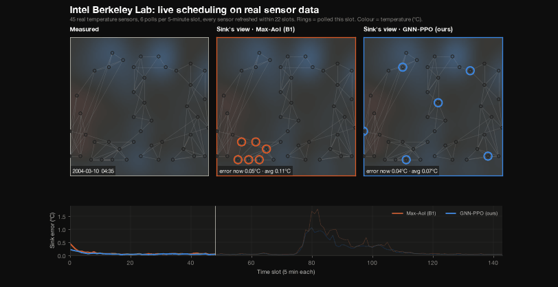
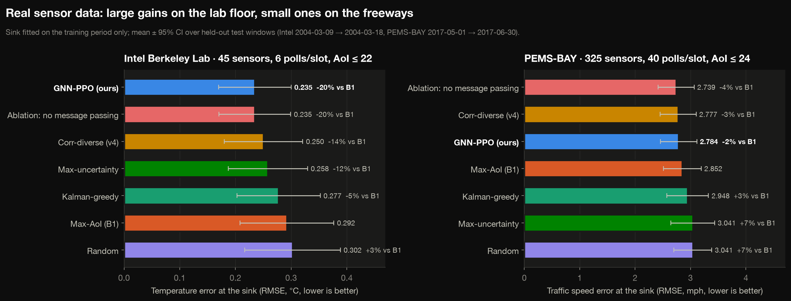
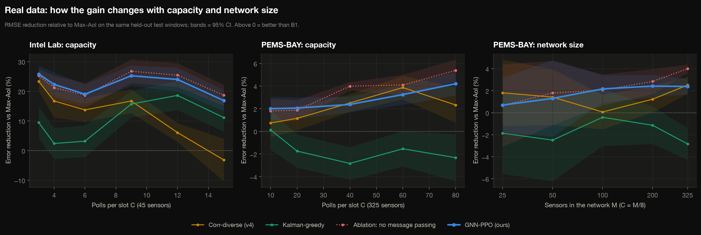
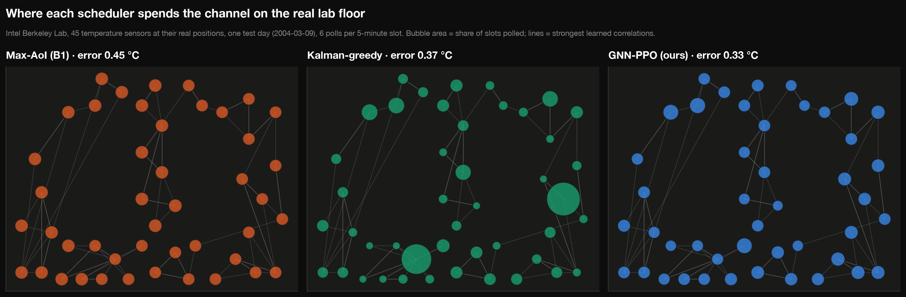
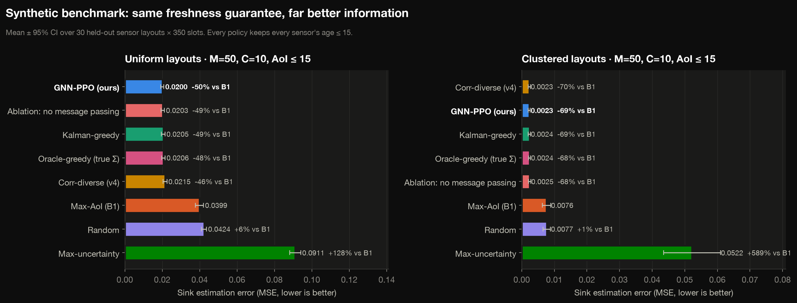
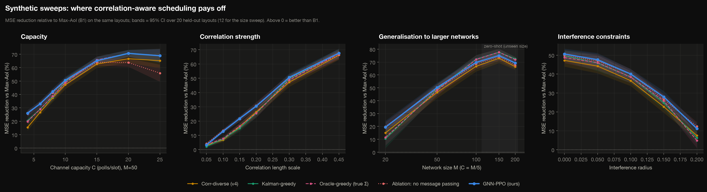
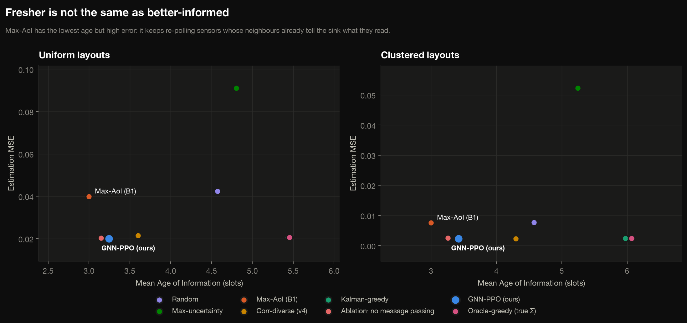
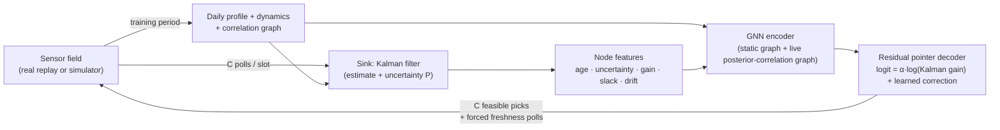
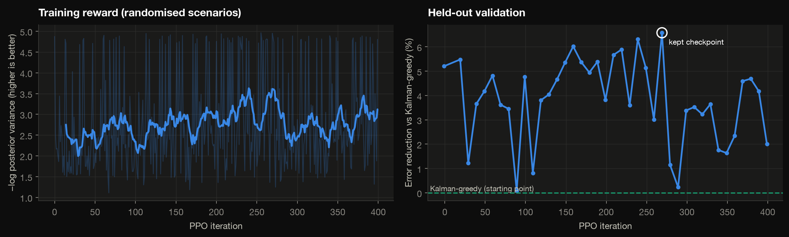

# GNN-AoI · Correlation-aware sensor scheduling with graph neural networks

[](https://github.com/BhanuPrasadPalella-01/gnn-aoi-scheduler/actions/workflows/tests.yml)



A sink watches **M sensors** but can poll only **C per slot**. Classic Age-of-Information (AoI)
scheduling polls whoever is stalest. But when sensors are **correlated**, a fresh reading from one
sensor also tells you a lot about its neighbours. Polling purely by age wastes the channel on
redundant information.

This project learns a scheduler that knows this, and tests it on **real sensor networks**:

1. it **learns the correlation graph and each sensor's daily pattern** from historical data,
2. measures staleness as **what the sink still doesn't know** (Kalman posterior uncertainty), not raw age,
3. uses a **graph neural network trained with PPO** to choose which sensors to poll,
4. while every policy, ours included, guarantees **no sensor's age exceeds a hard bound**.

## Real data

| Dataset | Sensors | What | Slot | Train period | Test period |
|---|---:|---|---|---|---|
| [Intel Berkeley Research Lab](https://db.csail.mit.edu/labdata/labdata.html) | **45** | Temperature on a 40 m × 31 m lab floor | 5 min | 28 Feb – 8 Mar 2004 | 9 – 18 Mar 2004 |
| [PEMS-BAY](https://zenodo.org/record/5146275) | **325** | Freeway traffic speed, San Jose | 5 min | Jan – Apr 2017 | May – Jun 2017 |

The sink fits everything (daily profile, dynamics, correlation graph) on the training period only.
Every number below comes from held-out test-period windows, replayed slot by slot: polling a sensor
returns exactly what it really measured. The Intel recording has two network outages (10–11 and 15–16 March);
no evaluation window or live replay ever crosses one.

### Headline results on real data

Sink error in physical units (RMSE, lower is better), mean over held-out test windows. Every policy keeps
every sensor's age ≤ 3M/C slots (Intel: 22 slots ≈ 1.8 h; PEMS: 24 slots = 2 h).

| Policy | Intel Lab, 45 sensors, 6 polls/slot | PEMS-BAY, 325 sensors, 40 polls/slot |
|---|---:|---:|
| **Max-AoI (B1)**, classic | 0.292 °C | 2.85 mph |
| Random | 0.302 °C (+3%) | 3.04 mph (+7%) |
| Max-uncertainty | 0.258 °C (−12%) | 3.04 mph (+7%) |
| Kalman-greedy (model-based) | 0.277 °C (−5%) | 2.95 mph (+3%) |
| Corr-diverse (v4), mid-sem heuristic | 0.250 °C (−14%) | 2.78 mph (−3%) |
| **GNN-PPO (ours)** | **0.235 °C (−20%)** | **2.78 mph (−2%)** |

* **Intel Lab: −20% error vs Max-AoI.** GNN-PPO beats Kalman-greedy on **10/10** test windows (p = 0.002) and
  the best heuristic on 8/10 (p = 0.05).
* **PEMS-BAY: small gain, honest result.** Traffic correlation is sparse (only neighbouring detectors on the
  same freeway) and driven by sudden incidents, so there is little redundancy to exploit. In normalised error
  GNN-PPO beats Max-AoI and Kalman-greedy on **15/15** windows (p = 6·10⁻⁵) and v4 on 13/15 (p = 0.02), but in mph
  it ties v4 and is only 2% better than Max-AoI.
* **Real data breaks the model-based scheduler.** Kalman-greedy is the strongest method on synthetic data, but on
  real traffic it is *worse* than plain round robin: the sink's Gaussian model is off by 2–3× on real data.
  The learned scheduler was fine-tuned on historical data and corrects for this.







## Live demo website

```bash
python -m gnn_aoi serve
```

Then open **http://localhost:8000**. It runs only on your machine and needs no internet. The schedulers
run live on the real recordings while you watch:

* **Maps:** the measured field next to what the sink believes under each scheduler, with every transmission
  animated as a packet flying from the sensor to the sink (amber = forced by the freshness rule).
* **Controls:** dataset, test day and start time, channel capacity, which schedulers to compare, colouring
  (reading / sink error / uncertainty) and playback speed. Keyboard: space = play/pause, → = one slot, R = restart.
* **"Why these sensors?":** each scheduler's priority for every sensor in the current slot and the order it picked them.
* **Live charts:** error over time, a transmission log, and running KPIs.
* **"How it works" and "Results" tabs** to walk an audience through the method and the benchmark.

## Live transmission engine

`gnn_aoi/live.py` replays a real dataset slot by slot and runs several schedulers side by side on
identical readings. Each slot emits one JSON event describing the slot:

* the real readings and the timestamp,
* which sensors each scheduler polled, in decision order, and which were **forced** by the freshness guarantee,
* each scheduler's **per-sensor priority** (why it chose them),
* the sink's estimate and uncertainty for every sensor, plus running error and AoI.

This is the backend for the frontend demo.

```bash
python -m gnn_aoi live
```

```bash
python -m gnn_aoi live --dataset pems_bay --speed 8
```

Pre-computed sessions (one test day each) are in `results/data/live_intel_lab.json` and `live_pems_bay.json`.

## Synthetic benchmark (controlled experiments)

The simulator gives ground truth (true covariance → an oracle) and lets us sweep every parameter.
50 sensors, 10 polls/slot, AoI ≤ 15, 30 held-out layouts. Values are MSE, lower is better.

| Policy | Uniform layouts | Clustered layouts |
|---|---:|---:|
| Max-AoI (B1) | 0.0399 | 0.0076 |
| Corr-diverse (v4) | 0.0215 (−46%) | 0.0023 (−70%) |
| Kalman-greedy | 0.0205 (−49%) | 0.0024 (−69%) |
| Oracle-greedy (knows true Σ) | 0.0206 (−48%) | 0.0024 (−68%) |
| **GNN-PPO (ours)** | **0.0200 (−50%)** | **0.0023 (−69%)** |

* **Uniform layouts:** GNN-PPO beats Kalman-greedy on 73% of layouts (p = 0.008) and the true-covariance oracle on 70% (p = 0.003).
* **Clustered layouts:** with 50 sensors packed into a few clusters the field is so redundant that every
  correlation-aware method gets ~69% lower error than Max-AoI and they statistically tie.
* **Fresher too:** mean AoI is 3.2 slots, vs 5.4 for Kalman-greedy.
* **Without a freshness guarantee**, Kalman-greedy never polls **18 of the 50 sensors** (they look "predictable",
  until one fails). The GNN starves none and still has the lowest error.







## How it works



* **Sink model.** Each sensor's reading is its typical daily profile (time of day, plus weekday/weekend for
  traffic) plus a deviation that follows per-sensor AR(1) dynamics with spatially correlated innovations,
  all fitted on the training period. A Kalman filter tracks the deviations. Its posterior variance `P_ii` is a
  principled "age of correlated information": how unsure the sink is about sensor *i* given everything it
  has heard from *i* **and its neighbours**.
* **Policy.** A dense message-passing GNN over two graphs (the learned correlation graph and the live
  posterior-correlation graph) feeds an **autoregressive pointer decoder**. Each pick's logit is the exact
  Kalman variance reduction (recomputed after every pick) plus a learned GNN correction plus a learned
  pairwise interaction. At initialisation the corrections are zero, **so the untrained network is exactly
  Kalman-greedy**. PPO only has to learn when looking ahead, or distrusting the model, beats it.
* **Training.** PPO on a mix of (a) randomised synthetic networks of 10–100 sensors (capacity, correlation
  length, per-sensor dynamics, layout, freshness, interference all randomised; reward = true posterior
  variance) and (b) replays of the real datasets' *training period* on sensor sub-networks (reward = actual
  estimation error). About 35 minutes on a laptop CPU, resumable. Test periods and test layouts are never seen.



## Honest findings and limitations

* **Where it helps most:** dense spatial correlation and a scarce channel (Intel Lab, clustered layouts).
  On sparse, incident-driven data (freeway traffic) every scheduler is within a few percent of round robin.
* **Message passing:** on synthetic data the full GNN significantly beats an ablation without message passing
  (clustered layouts: 87% of layouts, p = 3·10⁻⁶). On the real datasets the two are statistically tied
  (Intel p = 1.0, PEMS-BAY p = 0.2). Much of the real-data gain comes from learned timing on top of Kalman
  features rather than from neighbour messages.
* **Very large synthetic networks:** at 100–200 simulated sensors Kalman-greedy has 9–12% lower error than the
  GNN. Both are still ~70% better than Max-AoI, but the learned policy doesn't win there.
* **Compute:** at 325 sensors a decision takes ~17–27 ms on a laptop CPU (Kalman-greedy ~10–22 ms). That's
  negligible against a 5-minute slot.
* **Model scope:** reliable channel, no energy budget; unreliable links and battery-aware scheduling are natural next steps.

## Run it

```bash
python3 -m venv venv && source venv/bin/activate && pip install -r requirements.txt
```

```bash
python -m gnn_aoi download
```

```bash
python -m gnn_aoi live
```

```bash
python -m gnn_aoi train
```

```bash
python -m gnn_aoi all
```

```bash
python -m pytest
```

* `download` fetches the two datasets (~120 MB) into `data/raw/`.
* `live` shows the schedulers running on real data in the terminal.
* `train` re-trains the GNN (~35 min). It's resumable: re-run the same command after an interruption.
* `all` runs every experiment (~10 min), then renders every figure and the GIF.

## Deploy the live demo (Render)

The repo is ready to host on [Render](https://render.com) as-is, in either of two ways.

**With Render connected to this GitHub account (Blueprint):**

1. On Render: **New → Blueprint**, pick this repository, **Apply**.
   `render.yaml` sets everything: a free Python web service that installs `requirements-serve.txt`
   (NumPy + CPU-only PyTorch) and runs `python -m gnn_aoi serve`, with `/health` as the health check.
2. Open the URL Render gives you. Every push to `main` redeploys automatically.

**From any Render account (public repository URL):**

1. **New → Web Service → Public Git Repository**, paste
   `https://github.com/BhanuPrasadPalella-01/gnn-aoi-scheduler`.
2. Fill in:

   | Setting | Value |
   |---|---|
   | Runtime | Python 3 |
   | Branch | `main` |
   | Build command | `pip install -r requirements-serve.txt` |
   | Start command | `python -m gnn_aoi serve` |
   | Instance type | Free |
   | Health check path (Advanced) | `/health` |
   | Environment variable (Advanced) | `PYTHON_VERSION` = `3.13.5` |

3. Create the service. Public-URL services don't redeploy on push: use **Manual Deploy → Deploy latest
   commit** after changes.

The server binds to Render's `$PORT` automatically and needs about 200 MB of memory, rising to about 420 MB
once a PEMS-BAY session is open, which fits the free tier's 512 MB. The processed datasets and pre-fitted
sink models it needs (`data/processed/`, ~20 MB) are committed, so nothing is downloaded at start-up.
Free instances sleep when idle, so open the page a minute before presenting.

Vercel isn't a fit for the live demo: it runs short-lived serverless functions, while the schedulers keep
state between slots and need PyTorch.

## Project layout

```
gnn_aoi/
  config.py            Scenario: one dataclass for every knob
  datasets.py          Intel Lab + PEMS-BAY: download, cleaning, daily profiles, replay (TraceField)
  simulator.py         Synthetic correlated field + linear-Gaussian model fitting
  graphs.py            Correlation / interference graphs
  estimator.py         Kalman sink
  selection.py         Feasible top-C and greedy variance reduction
  env.py               Slot protocol, freshness guard, metrics, replay recording
  live.py              Live transmission engine (backend for the frontend demo)
  server.py            Local web server + JSON API for the demo (standard library only)
  policies/            Baselines + GNN policy wrapper (each can explain its priorities)
  gnn/                 Features, model (encoder + residual pointer decoder), resumable PPO trainer
  experiments.py       Every experiment -> results/data/*.json
  viz/                 Figures and the animation
frontend/              Live demo website (plain HTML/CSS/JS, no build step)
tests/                 21 tests (incl. no-test-leakage, recording-gap and legacy-bug regression tests)
results/data/          Experiment outputs + live sessions (JSON, ready for a frontend)
results/figures/       Figures + GIF
checkpoints/           Trained GNN + ablation
legacy/                The original mid-semester scripts (see legacy/README.md)
```

### Data for the frontend

| File | Contents |
|---|---|
| `live_intel_lab.json`, `live_pems_bay.json` | One test day of live events (`meta` + per-slot `events`) for Max-AoI, Kalman-greedy and GNN-PPO |
| `real_main.json`, `significance.json` | Real-data headline + per-window win rates / p-values |
| `real_capacity_*.json`, `real_scale.json` | Real-data sweeps |
| `poll_frequency.json` | Per-sensor polling share on the real lab floor |
| `replay.json` | Recording that drives the animation |
| `main.json`, `capacity.json`, `correlation.json`, `scale.json`, `interference.json`, `pilot.json`, `unconstrained.json` | Synthetic experiments |
| `training_log.json` | PPO curve and validation history |

## What changed from the mid-semester version

* **Fixed a critical bug.** The correlation graph was estimated on sensors drawn with `seed=42`, but every
  evaluation ran on `seed=123`, which places the sensors differently (r = 0.04 between the graph used and
  the true one). All earlier "correlation-aware" results were measuring an unrelated graph.
* **Real data and more sensors.** 45 real lab sensors and 325 real traffic sensors (previously 20 simulated).
* **Replaced the AoCI proxy** (which sat at about 1.0 for every policy) with the sink's real estimation error.
* **Put a GNN in the scheduler.** Before, the GraphSAGE model was a standalone test and the PPO policy was an
  MLP that did 2–5× worse than round robin.
* Added the freshness guarantee, interference constraints, 6 baselines, multi-window evaluation with CIs and
  significance tests, sweeps, ablation, the live engine, tests, CLI and figures.

See [docs/related_work.md](docs/related_work.md) for positioning against the AoCI and GNN-scheduling literature.


## Data sources

* **Intel Berkeley Research Lab**: P. Bodik, W. Hong, C. Guestrin, S. Madden, M. Paskin, R. Thibaux, 2004.
  <https://db.csail.mit.edu/labdata/labdata.html>
* **PEMS-BAY**: Caltrans Performance Measurement System, as prepared by Y. Li, R. Yu, C. Shahabi, Y. Liu,
  *Diffusion Convolutional Recurrent Neural Network*, ICLR 2018. CSV copy:
  <https://zenodo.org/record/5146275>

`data/processed/` holds the cleaned 5-minute series derived from them; `python -m gnn_aoi download` fetches the
raw files to rebuild everything.
